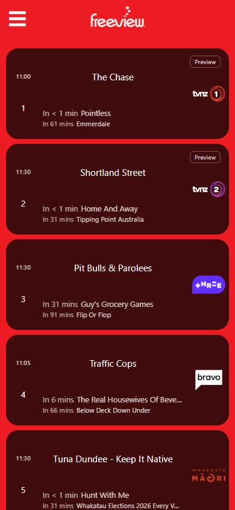
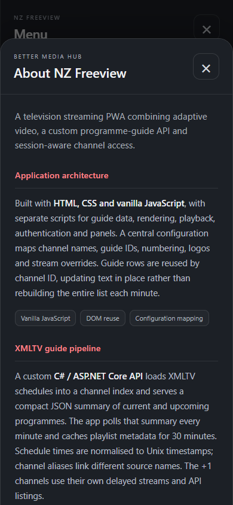

# NZ Freeview PWA

A television streaming PWA built with vanilla JavaScript, a custom programme-guide API and ASP.NET session endpoints. This repository contains the application code; deployment-specific guide and stream URLs stay in an ignored local configuration file.

## Live product

**[Open NZ Freeview](https://freeview.bettermediahub.com/)**

The live app is available to explore as a guest. TVNZ channels have a shared two-minute preview; sports are available after sign-in. It can also be installed as a PWA from a supported browser.

| Programme guide | Engineering About |
| --- | --- |
|  |  |

## Engineering overview

- HTML5 video with Video.js for HLS and dash.js for MPEG-DASH. Player libraries load on demand; channel changes dispose the old player and ignore stale callbacks.
- Guide API integration with a compact batch request each minute, playlist metadata cached for 30 minutes, explicit channel aliases and guide-ID mappings, and independent +1 schedules.
- Guide rows reused by channel ID, safe text updates, request deduplication and exponential retries while retaining the last successful listings in memory.
- Buffering detection based on actual playback progress. Temporary stalls can recover without the app closing the player.
- C# ASP.NET handlers on IIS validate the private users file. An encrypted, Secure, HttpOnly, SameSite cookie restores login for up to 30 days.
- Guests can see the Freeview channels. TVNZ channels share a two-minute preview and a 30-minute cooldown; sports appear after sign-in.
- Responsive portrait and landscape layouts, safe-area spacing and dedicated standalone-PWA sizing. A service worker revalidates static assets and provides a saved-file fallback; video, guide API and authentication requests bypass that cache.

The guest preview is a browser policy. Keeping URLs outside Git also does not conceal URLs delivered to a viewer's browser. Enforcing access to the actual media requires protection at the streaming server.

## Private configuration

1. Copy the example settings:

   ```powershell
   Copy-Item js/config.local.example.js js/config.local.js
   ```

2. Edit `js/config.local.js` with your guide API address and authorised stream URLs. The example uses reserved `.example` addresses.
3. Keep that local file on the deployment server. It is loaded after `js/config.js` and must never be committed.

The development copy can retain its real local settings while the repository uses empty defaults and examples. Missing private configuration does not fall back to the playlist URLs for channels with required overrides.

`App_Data/`, `archive/`, build output, account files and local endpoint settings are excluded by `.gitignore`. Do not upload maintenance backups; they may contain previous configurations.

## Hosting

The app uses classic ASP.NET `.ashx` handlers and `App_Code` on Windows IIS with .NET Framework 4.8 and HTTPS. It has no npm build step. This is the current application; the previous MVC project is kept only in the ignored local archive.

- Deploy the application files and your ignored `js/config.local.js` to the IIS application directory. Keep HTTPS redirection, session cookies and hidden-directory rules from `web.config`.
- Supply the account file outside the web root. The path is configured in `App_Code/FreeviewAuthentication.cs`; use the existing private user-file format. Do not add real account data to this repository.
- Connect a compatible guide API and allow your app's origin in its CORS policy. That API is hosted separately and its source is not part of this repository.
- The browser interface can be previewed statically, but login and the ASP.NET proxy handlers require IIS; GitHub Pages does not run them.

Guide API contracts used by the adapter:

| Request | Response |
| --- | --- |
| `GET /playlists/{playlistId}` | M3U channel metadata, guide IDs and stream directives |
| `GET /guide/summary?channels={comma-separated-ids}` | JSON `channels` dictionary with `start`, `stop` and `title` programme fields |
| `GET /guide/channel-programmes/{playlistId}/{guideId}` | Per-channel fallback when the summary endpoint returns 404 or 405 |

These paths are relative to `guideApiBaseUrl`. Compact programme timestamps are Unix seconds; the adapter also accepts offset-bearing XMLTV date strings from the older endpoint.

## Verification

Run the JavaScript checks with Node.js:

```powershell
node --test tests/*.test.cjs
```

The Windows authentication checks use a temporary users fixture and real ASP.NET MachineKey protection. See [tests/README.md](tests/README.md) for the commands and [tests/requests.http](tests/requests.http) for manual session requests. Do not save real passwords in committed request examples.

Browser checks have covered actual HLS playback, simulated authentication transitions, preview expiry, reload persistence, keyboard focus, dialogs and both orientations. Safari's installed-app sizing also needs validation on a physical device.

Channel logos, programme listings and media remain with their respective owners. This repository does not distribute media or grant access to third-party streams.
